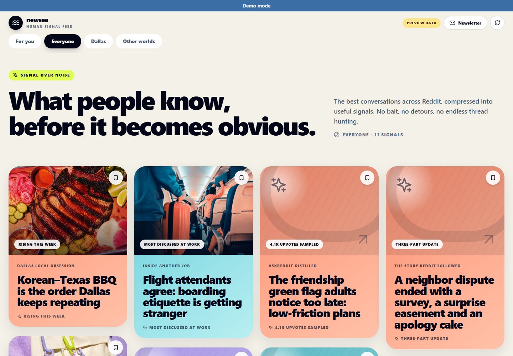

# Newsea

**The best of Reddit, made instantly useful.**

**🌐 Live demo:** <https://jayneechiu.github.io/newsea/>

[](https://jayneechiu.github.io/newsea/)

Newsea turns high-signal Reddit conversations into a visual, scrollable feed.
Each card leads with the useful conclusion, then expands in place to show the
strongest takeaways and the communities behind them.

> See what everyone—and everyone unlike you—is talking about.

> **About the demo:** it is a static build with no hosted backend. The **Live from
> Reddit** lane is a real snapshot refreshed every two days
> ([how it works](#live-data-on-a-static-site)); the other lanes use curated sample
> cards. Login is simulated, so newsletter sign-up and admin actions are inactive.

Newsea is a non-commercial portfolio project and product prototype.

## Why Newsea

Recommendation systems are good at showing people more of what they already
like. They are less useful for answering:

- What is everyone paying attention to right now?
- What is changing in my city?
- What does a community outside my usual feed know that I do not?
- Which parts of a long discussion are worth remembering?

Newsea explores a **human signal feed**: Reddit's community knowledge organized
into concise visual cards.

## Features

- **Lanes:** Live from Reddit, For you, Everyone, Dallas (local lens), and Other
  worlds (communities outside your routine).
- **Cards:** a complete headline, why it matters, three expandable takeaways, and
  links to the original threads. Cards can be saved or hidden locally.
- **English / 中文 toggle** for the UI and card content.
- **Responsive masonry layout:** four columns on desktop, one on mobile.
- **Newsletter (`/newsletter`):** a slower weekly digest built from the same cards.
  Sign-ups are stored as pending requests, and the owner approves them at
  `/newsletter/admin` before any email is sent.
- **Graceful fallback:** if the live feed is unavailable or empty, the UI shows
  labeled preview cards instead of an empty page.

## Live data on a static site

The public demo has no server or database, yet the Live lane shows real threads.
It follows the "git scraping" / [Flat Data](https://githubnext.com/projects/flat-data/)
pattern: a scheduled job writes a flat JSON file that the static site reads.

```text
GitHub Actions cron, every 2 days (.github/workflows/live-snapshot.yml)
    ↓
Reddit API (read-only app auth) → hot threads + top comments
    ↓
one OpenAI call per thread → English + Chinese context and takeaways
    ↓
live-cards.json → force-pushed to the single-commit `live-data` branch
    ↓
pages.yml builds dev, adds the snapshot → https://jayneechiu.github.io/newsea/
```

- **Why every two days:** the demo should feel current, not real time. About 12
  short `gpt-4o-mini` calls per run costs under $0.10 a month and keeps Reddit
  API usage tiny.
- **Bilingual in one call:** the same request returns English and Chinese copy,
  so no translation service is needed.
- **Safe failure:** if OpenAI fails, cards fall back to raw post text and
  comments; if no cards are built, the previous snapshot stays. Without a
  snapshot the Live lane is hidden.
- **Secrets:** `REDDIT_CLIENT_ID`, `REDDIT_CLIENT_SECRET` and an optional
  `OPENAI_API_KEY` (dedicated, budget-capped) live in the `content-refresh`
  environment, restricted to `dev`.

## Quick start (no backend)

The visual prototype needs no PostgreSQL, Reddit, or OpenAI:

```bash
git clone https://github.com/jayneechiu/newsea.git
cd newsea/ui
npm install
npm run dev:mock        # http://localhost:3000
```

Mock mode reads `ui/src/data/demo-cards.json` and shows a **Preview data** badge
so sample content is never presented as a live trend.

Checks and the Pages build:

```bash
npm run typecheck
npm run lint
npm run build:demo      # same build as the live demo
npm run preview:demo    # http://localhost:4173/newsea/
```

To see the Live lane locally, build a snapshot from the repo root (needs Reddit
credentials in `.env`; written to the gitignored `ui/public/live/`):

```bash
python -m backend.scraper.build_live_snapshot --out ui/public/live/live-cards.json
```

## Full-stack development

The backend collects Reddit posts and comments (PRAW), summarizes them with
OpenAI, stores them in PostgreSQL, and serves them through FastAPI.

Requirements: Python 3.11+, PostgreSQL, Reddit API credentials, and an OpenAI
API key for AI enrichment.

```bash
python3.11 -m venv .venv
source .venv/bin/activate
pip install -r backend/api/requirements.txt
cp .env.example .env    # then fill in credentials

# API at http://localhost:8000 (docs at /docs)
INIT_IN_BACKGROUND=true python -m uvicorn backend.api.main:app --reload --port 8000

# Pull fresh Reddit posts into the database without emailing anyone
python -m backend.scraper.run_job --no-send
```

Then run the frontend in live mode with `npm run dev` in `ui/`. It requests
`/api/feed`, which builds cards from the most recent saved drafts.

Newsletter tools:

```bash
python3 scripts/send_test_newsletter.py --render-only     # render with preview cards
python3 scripts/send_test_newsletter.py --limit 4          # send via SMTP in .env
python3 scripts/render_live_newsletter.py --subreddit todayilearned --limit 4
```

`render_live_newsletter.py` produces HTML plus a reusable JSON package, so
previewing and sending reuse the same generated edition.

See [Local development](docs/local-development.md) for environment modes and
more commands.

## ContentCard contract

The UI is built around a structured `ContentCard`, not a raw Reddit post or
free-form AI summary:

```json
{
  "id": "dallas-bbq",
  "lane": ["everyone", "dallas"],
  "cardType": "local-trend",
  "theme": "coral",
  "eyebrow": "Dallas local obsession",
  "headline": "Korean–Texas BBQ is the order Dallas keeps repeating",
  "context": "Local food threads keep converging on the same dishes.",
  "takeaways": ["…", "…", "…"],
  "topics": ["food", "local", "dallas"],
  "sourceCount": 18,
  "communityCount": 6,
  "trendLabel": "Rising this week",
  "i18n": { "zh": { "headline": "…", "takeaways": ["…"] } },
  "sources": []
}
```

The UI stays stable while content generation evolves from curated fixtures to a
full ingestion, ranking, and enrichment pipeline. Missing `i18n.zh` fields fall
back to English.

## Roadmap

1. PostgreSQL Schema V3: comments, metric snapshots, `content_cards`, card
   sources, and interaction events.
2. Schema-validated card generation from posts and high-signal comments.
3. Move `/api/feed` from recent drafts to `content_cards`, with real For you,
   Dallas, and Other worlds lanes.
4. Candidate scoring for quality, velocity, novelty, repetition, and safety.
5. Host the backend so the full live feed is public.
6. Smoke tests and monitoring.

## Repository structure

```text
newsea/
├── .github/workflows/        # CI, Pages deploy, live snapshot cron
├── backend/
│   ├── api/                  # FastAPI service and Dockerfile
│   └── scraper/              # Reddit, OpenAI, PostgreSQL, newsletter, live snapshot
├── docs/                     # Schema and local development notes
├── scripts/                  # Newsletter and database utilities
├── templates/                # Newsletter templates
├── tests/                    # Backend tests
├── ui/
│   ├── src/components/       # Feed UI and ContentCard
│   ├── src/data/             # Curated preview cards
│   ├── src/pages/            # Feed, signal detail, newsletter
│   ├── src/services/         # API, live snapshot, and fallback feed
│   ├── src/types/            # ContentCard contract
│   └── src/i18n.tsx          # English / Chinese strings
└── docker-compose.yml
```

## Environment and data safety

- Never put Reddit, OpenAI, database, or SMTP credentials in a `VITE_` variable;
  Vite exposes those to the browser. Keep them in the root `.env` (gitignored)
  or in GitHub environment secrets.
- Preview cards are labeled and are not live measurements.
- Live content keeps attribution and source links, and stores minimal user
  identity.
- Commercial use of Reddit data requires Reddit's approval. Newsea is a
  non-commercial portfolio project.

## Technology

React, TypeScript, Vite, Tailwind CSS · Python, FastAPI, PRAW · PostgreSQL ·
OpenAI API · Docker · GitHub Actions and Pages

## Contributing

Issues and pull requests are welcome. See [CONTRIBUTING.md](CONTRIBUTING.md).

## License

[MIT](LICENSE). Reddit content belongs to its authors and communities. Newsea is
not affiliated with or endorsed by Reddit.